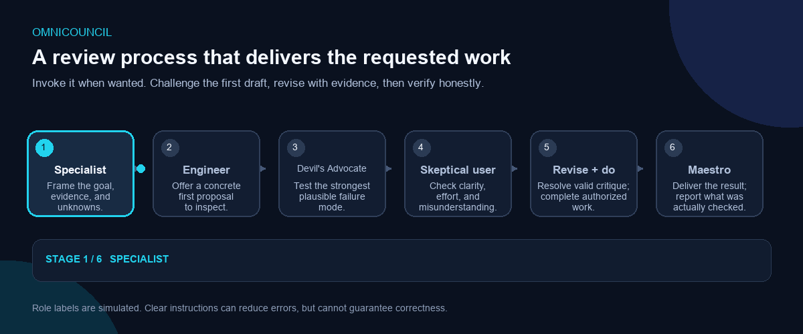

<!-- Copyright 2026 Mohamed Aouaci. SPDX-License-Identifier: Apache-2.0 -->

# OmniCouncil

[العربية](README.ar.md)

**An explicitly invoked critique, verification, and delivery workflow for AI assistants.** OmniCouncil routes a task to the relevant domain guidance, challenges a first proposal, revises it, and then completes the authorized request when tools permit.

> OmniCouncil can improve the process an assistant is asked to follow. It cannot make a model infallible, independently intelligent, or incapable of fabrication.

## How it works

The animated sequence is illustrative. See [the full process diagram](assets/omnicouncil-process.svg) and its plain-language explanation in [Arabic](README.ar.md).

### Evidence review, in one picture

This artwork explains the intended review flow. It is not a benchmark, test result, or evidence of a measured hallucination reduction.

| Stage | What the skill asks the assistant to do |
| --- | --- |
| Specialist | Identify the relevant principle, evidence, and important unknowns first. |
| Engineer | Make a concrete first proposal. |
| Devil’s Advocate | Test the strongest plausible failure mode without inventing a flaw. |
| Skeptical End User | Check effort, clarity, accessibility, and likely misunderstanding. |
| Revision | Resolve valid criticism, narrow unsupported claims, and identify unresolved risk. |
| Maestro | Deliver the revised answer or perform the authorized work, then accurately report verification. |

The familiar “AI as an employee who agrees with the boss” comparison is a **metaphor** for over-agreement and unsupported confidence. Models do not literally feel fear or intend to lie. OmniCouncil adds a factuality checkpoint: identify material claims, verify important ones against available evidence, check sources and calculations, look for counterevidence, and label what remains uncertain. These instructions can reduce avoidable errors; they cannot stop hallucinations or promise a percentage improvement.

The named roles are simulated perspectives unless the host actually starts separate agents. For important facts, the skill asks the model to turn draft claims into neutral questions, verify them against the source itself where possible, seek counterevidence, and mark remaining unknowns. A concise visible review is shown when the requested format allows it; hidden chain-of-thought is not exposed. The council critique must not replace implementation, research, or another concrete task the user requested.

## Invoke it only when you want it

OmniCouncil is **not intended to run for every conversation**. Use the host’s explicit command, or say “Use OmniCouncil for this request.”

| Host | Setup | Invocation and limit |
| --- | --- | --- |
| OpenAI Codex | Install the complete folder under **~/.codex/skills/omnicouncil/**. | Use **$omnicouncil**; the included Codex metadata disables implicit invocation. |
| Claude Code | Install under **.claude/skills/omnicouncil/**; add **disable-model-invocation: true** in the Claude-specific frontmatter. | Use **/omnicouncil**. This setting does not apply to Claude.ai or other Anthropic hosts. |
| Gemini CLI | Install with **gemini skills install**, then check **/skills list**. | Gemini CLI may auto-select enabled skills. For strict opt-in, keep it disabled or attach the file per task. |
| Gemini Apps | Put the workflow in a Gem's Instructions and selected references in Knowledge; for one-off use, attach them to a chat. | Select the Gem yourself and include an explicit trigger rule. This is not a Gemini CLI skill-folder install. |
| ChatGPT | Attach **SKILL.md** for one task; where GPT creation is available, put the workflow in Instructions and references in Knowledge. | Account availability changes. Keep a trigger rule; global Custom Instructions affect chats beyond OmniCouncil. |
| Kimi Code / Agent Mode | Kimi Code supports **SKILL.md**; Kimi Agent Mode has a Skills panel and slash picker. | Kimi can auto-select relevant skills; the ZIP is not a universal import format for every Kimi surface. |
| GLM / Z.ai and DeepSeek | In chat apps, use supported custom instructions or attach the file per request. In APIs, use the documented system/instructions message and provide references separately. | No universal skill-folder installer is claimed for their chat apps. |
| Other cloud agents | Use the host's documented skill, prompt, knowledge, or retrieval mechanism. | Compatibility and manual invocation depend on the host, not the model name alone. |

No one package can install itself in every model or AI app. Skills belong to a **host product or agent runtime**, not to a model in isolation. See [INSTALLATION.md](INSTALLATION.md) for current platform steps and fallback instructions. Compatibility here means “the files can be adapted,” not “behavior has been tested on every model.”

## Package contents

- `SKILL.md` — explicit invocation, role workflow, evidence/candor rules, task completion, routing, and output limits.
- `agents/openai.yaml` — Codex metadata and explicit-only policy.
- `references/` — selective guidance for software, AI/ML, games/3D, product ideas, research, writing, and general problem-solving.
- `examples/` — concise output examples, including when no material flaw is found.
- `assets/` — process diagram, animation, and conceptual evidence-review illustrations.
- `INSTALLATION.md` — platform-specific installation guidance and limitations.
- `README.ar.md` — Arabic overview and usage guide.
- `EVALUATION.md` — observable manual checks and release criteria.
- `HALLUCINATION-EVALUATION.md` — a paired evaluation protocol for measuring factual-error changes without inventing a percentage.
- `INSTRUCTION-GUIDE.md` — what instructions are intended to influence, and their limits.
- `CHANGELOG.md` — version history for user-visible changes.
- `LICENSE` — Apache License 2.0.

Reference files are **not** separately installed subskills. The main skill selects relevant references; only hosts that can access the package files can use them.

## Download

- [Download `onlySkills.zip`](https://github.com/medpy2013/omnicouncil-skill/raw/refs/heads/main/onlySkills.zip) — full package, with one top-level `omnicouncil/` folder.
- [Browse the source files](.) — inspect the instructions before installation.

## Evaluation and release honesty

The included test plan is a manual protocol, not a report of tests already passed. Run it on each platform/model/version you plan to support and publish the actual date and results. A structural check can catch broken frontmatter or missing files; it cannot prove model behavior. Never advertise “100% reliable,” “works everywhere,” or “cannot lie.”

## License and attribution

Licensed under Apache-2.0. Copyright 2026 Mohamed Aouaci. See [LICENSE](LICENSE). The license permits reuse under its terms; it does not certify performance or grant rights to third-party material included by downstream users.
