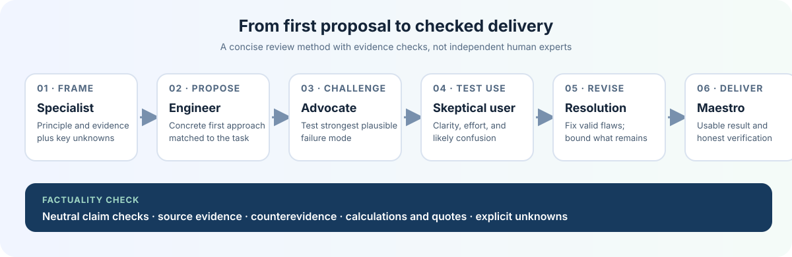

<!-- Copyright 2026 Mohamed Aouaci. SPDX-License-Identifier: Apache-2.0 -->

# OmniCouncil

[العربية](README.ar.md)

**A manually invoked AI skill for structured critique, factuality checks, and delivery of the authorized task.** It routes coding and general requests to only the relevant domain guidance.

[Download OmniCouncil v1.3.0](https://github.com/medpy2013/omnicouncil-skill/raw/refs/heads/main/onlySkills.zip)

## Workflow

1. A relevant specialist frames the key principle, evidence, and unknowns.
2. The engineer proposes a concrete first approach.
3. Devil’s Advocate and a skeptical end user test failure modes and usability. They may report no material flaw rather than invent one.
4. The proposal is revised to resolve valid criticism or bound remaining risk.
5. Maestro delivers the usable result and reports what was actually verified.

These are simulated perspectives from one model unless the host actually starts separate agents. The skill does not expose hidden chain-of-thought or replace doing the requested work.

## Candor and hallucination limits

The “AI agrees with the boss” comparison is a metaphor for over-agreement and unsupported confidence. Models do not literally feel fear or intend to lie. For important factual claims, OmniCouncil asks the model to form neutral verification questions, check source material, seek counterevidence, verify calculations and quotations, and mark what remains unknown.

These instructions aim to reduce avoidable errors. They cannot stop hallucinations or guarantee a fixed improvement. No percentage reduction has been measured for this package. A paired evaluation protocol is included in the ZIP.

## Invoke only when you want it

In Codex, extract the ZIP and place the omnicouncil folder under ~/.codex/skills/omnicouncil/, then invoke it with $omnicouncil. Codex metadata disables implicit invocation.

Claude Code can use /omnicouncil with its host-specific manual-only setting. Gemini CLI may activate skills automatically by relevance, so this package cannot guarantee manual-only invocation there. For other AI apps, attach SKILL.md and the relevant reference file and explicitly request OmniCouncil. Skill support depends on the host application, not the model alone.

## Package and checks

The ZIP contains the portable skill, seven selective references, examples, English and Arabic guides, installation steps, evaluation protocols, visual assets, and Apache-2.0 license. It extracts to one top-level omnicouncil/ folder. Structural manifest and archive checks passed for v1.3.0; manual model behavior tests have not yet been run.

Never advertise 100% reliability or an unmeasured hallucination reduction. See the included evaluation guide before making performance claims.

## License

Apache-2.0. Copyright 2026 Mohamed Aouaci. See LICENSE.
